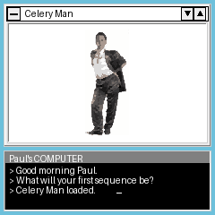
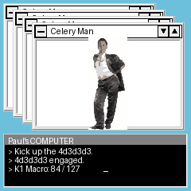
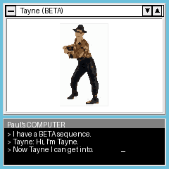
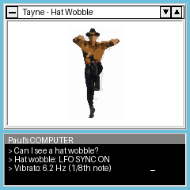
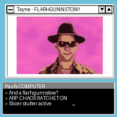
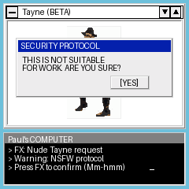
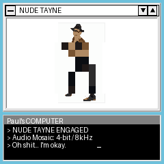
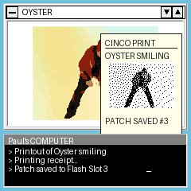
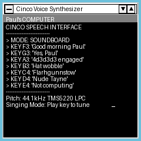

# CINCO IDENTITY GENERATOR 2.5™
### Professional Workstation Edition for the M-VAVE FM-1 Synthesizer Terminal
**Cinco Business Systems, Inc. — "Your Complete Workplace Identity & Charisma Solution"**

```
================================================================================
CINCO BUSINESS SYSTEMS, INC.                                             [v2.5]
Part No. 04-4D3D3D3-925                              Retail Boxed Edition (1995)

   CCCCCC   II  NN   NN   CCCCCC   OOOOOO    
  CC        II  NNN  NN  CC       OO    OO   
  CC        II  NN N NN  CC       OO    OO   
  CC        II  NN  NNN  CC       OO    OO   
   CCCCCC   II  NN   NN   CCCCCC   OOOOOO    

         ** I D E N T I T Y   G E N E R A T O R   2 . 5 ™ **
             "Your Complete Workplace Entertainment Solution"

   [ 4d3d3d3™ ACCELERATED ]            [ SOUND BLASTER 16 / ADLIB COMPATIBLE ]
   [ IBM PC & COMPATIBLES / M-VAVE ]   [ INCLUDES 3.5" HIGH DENSITY DISKETTE ]
   [ DESIGNED FOR WINDOWS 3.1 & DOS ]  [ NOW WITH NUDE TAYNE™ (NOT SFW) ]
================================================================================
```

[-00ff66?style=for-the-badge&logo=webassembly&logoColor=black)](https://mrjoshida.github.io/CINCO/)
[](docs/cinco/manual.md)
[](https://github.com/mrjoshida/CINCO)
[](build/felucca.fwsc)
[](docs/cinco/plan.md)
[](LICENSE)

> ### 🕹️ **[PLAY IN BROWSER NOW: https://mrjoshida.github.io/CINCO/](https://mrjoshida.github.io/CINCO/)**
> **No hardware required! Experience CINCO OS 2.5 live in your browser via WebAssembly synthesis & ST7789 display simulation.**

---

## EXECUTIVE SUMMARY & PRODUCT OVERVIEW

Are your enterprise personnel suffering from terminal mid-afternoon spreadsheet lethargy? Does your open-plan cubicle farm lack digitized kinetic charisma? 

Welcome to **CINCO IDENTITY GENERATOR 2.5™**, the premier corporate identity synthesizing suite engineered by **Cinco Business Systems, Inc.** specifically for the **M-VAVE FM-1 Synthesizer Terminal**. Engineered to the exacting specifications of Cinco Executive Workstations, this custom firmware turns your pocket FM synthesizer into **CINCO OS 2.5**: an interactive, high-performance musical workstation running the **Cinco Identity Generator 2.5** enterprise suite for executive user Paul.

Unlike passive terminal monitors or static office tools, **Cinco 2.5 is an instrument first**. Every sequence protocol is mapped directly to hardware controls: identity routines are synthesizer voice models, `4d3d3d3` is an analog macro encoder, `Nude Tayne` crushes audio bit-depth and mosaic-censors pixels simultaneously, and the corporate computer voice sings speech synthesis directly from the 27-key capacitive keyboard.

```
+--------------------------------------------------------------------------+
|  "Computer, can I get a 4d3d3d3 engaged?"                                |
|  "Yes, Paul."                                                            |
|  ...                                                                     |
|  "Could you kick up the 4d3d3d3?"                                        |
|  "I have a BETA sequence I have been working on. Would you like to see?" |
|  "Can I get a Hat Wobble? And a Flarhgunnstow?"                          |
|  "I can't wait to entertayne you."                                       |
+--------------------------------------------------------------------------+
```

---

## RETAIL HIGHLIGHTS & KEY TECHNOLOGIES

* **Proprietary 4d3d3d3™ Cascading Window Architecture:** Rotate Knob 1 (`K1`) to duplicate and cascade up to 16 overlapping desktop windows in real-time across the 240×240 LCD while expanding stereo chorus width and harmonic sub-oscillators.
* **Rotoscoped SCUMM Engine Sprites:** Every dancer is meticulously rotoscoped frame-by-frame from original footage into authentic 16-color 96×128 pixel sprites, animated at 12–15 FPS using color-keyed RLE compression.
* **The Full Identity Roster:**
  * **Celery Man:** The classic corporate dancer in dark business attire. Drives a lush multi-oscillator analog brass synthesizer.
  * **Oyster Smiling:** A soothing, meditative portrait providing moral support during quarterly ledger reconciliations.
  * **Tayne (BETA):** High-tempo prototype entertainer engineered for maximum kinetic morale.
* **Interactive Macro Kinetics:**
  * **Hat Wobble (`LFO`):** Real-time millinery oscillation introducing resonant filter wobble and fedora pitch modulation.
  * **Flarhgunnstow (`ARP`):** High-frequency kinetic syncopation driving the arpeggiator and rapid footwork.
  * **Nude Tayne (`FX`):** Direct latch toggle engaging dynamic censor mosaic and lo-fi audio bitcrush saturation with a 1-second NSFW alert banner.
* **Hardware Robot Speech Synthesizer (`GLO`):** Linear Predictive Coding (LPC) formant speech engine cycling through 9 iconic quotes ("Yes, Paul.", "Now Tayne I can get into.", "4d3d3d3 engaged.", "Hat wobble.", "Flarhgunnstow.", "Printout of Oyster smiling.", "Celery Man.", "Tayne.", "Beta."). Press `HOME + GLO` or tap 8 times to trigger the Floppy Celery Easter egg (`ERR 0xCE1E`). Hold `GLO` or press `GLO + EDIT` to toggle the Diagnostic HUD.
* **Stealth Workplace Productivity Suite:**
  * **Lotus 1-2-3 Boss Key (`EDIT`):** One-touch emergency cloaking mechanism. Instantly blanks the display with a convincing 1993 corporate balance sheet while music continues playing in the background; touch any key or turn any knob to wake back to the desktop.
  * **Norton Disk Defragmenter (`SEQ`):** Real-time visual 16-block memory cluster defragmentation with animated cluster allocation; upon reaching 100% (240 clusters optimized), affirms completion with speech and automatically restores the dancers desktop.
  * **After Dark "Flying Celery" Screensaver:** Preserves phosphor lifespan during coffee breaks by floating pixelated celery stalks against a void black canvas.

---

## VISUAL SCREENSHOT GALLERY

### Desktop Operations (CINCO OS 2.5)

| [01: Idle Celery](docs/cinco/mock/01_idle_celery.png) | [02: 4d3d3d3 Engaged](docs/cinco/mock/02_4d3d3d3_engaged.png) | [03: Tayne BETA](docs/cinco/mock/03_tayne_beta.png) |
|:---:|:---:|:---:|
| <a href="docs/cinco/mock/01_idle_celery.png"></a> | <a href="docs/cinco/mock/02_4d3d3d3_engaged.png"></a> | <a href="docs/cinco/mock/03_tayne_beta.png"></a> |
| *Standard desktop session* | *Cascading window acceleration* | *Prototype entertainer initialized* |

| [04: Hat Wobble](docs/cinco/mock/04_hat_wobble.png) | [05: Flarhgunnstow](docs/cinco/mock/05_flarhgunnstow.png) | [06: NSFW Warning](docs/cinco/mock/06_nsfw_warning.png) |
|:---:|:---:|:---:|
| <a href="docs/cinco/mock/04_hat_wobble.png"></a> | <a href="docs/cinco/mock/05_flarhgunnstow.png"></a> | <a href="docs/cinco/mock/06_nsfw_warning.png"></a> |
| *Headwear harmonic resonance* | *Maximum kinetic overdrive* | *Regulatory compliance prompt* |

| [07: Nude Tayne](docs/cinco/mock/07_nude_mosaic.png) | [08: Oyster Printout](docs/cinco/mock/08_oyster_printout.png) | [09: Talk Soundboard](docs/cinco/mock/09_talk_soundboard.png) |
|:---:|:---:|:---:|
| <a href="docs/cinco/mock/07_nude_mosaic.png"></a> | <a href="docs/cinco/mock/08_oyster_printout.png"></a> | <a href="docs/cinco/mock/09_talk_soundboard.png"></a> |
| *Mosaic censorship & bitcrush* | *Dot-matrix printout of Oyster* | *Speech response matrix* |

---

### Digitized Rotoscoped SCUMM Sprites

| Celery Man | Tayne (BETA) | Tayne Hat Wobble | Tayne Flarhgunnstow | Oyster Smiling |
|:---:|:---:|:---:|:---:|:---:|
| <br/>`celery_scumm_loop.gif` | <br/>`tayne_scumm_loop.gif` | <br/>`tayne_hatwobble_scumm_loop.gif` | <br/>`tayne_flarh_scumm_loop.gif` | <br/>`oyster_scumm_loop.gif` |

---

## HARDWARE CONSOLE MAP & OPERATOR CONTROLS

The Cinco Identity Generator 2.5™ maps seamlessly onto the **M-VAVE FM-1** hardware console:

```
+-------------------------------------------------------------------------+
|                  CINCO OS 2.5 HARDWARE CONSOLE                          |
|                                                                         |
|  [SELECT]           [ALGO]            [PRESET]            [OCT - / +]   |
|  Console Nav      Groove Style      Select Character     Key Transpose   |
|                                                                         |
|    [K1]               [K2]              [K3]                [K4]        |
|   4d3d3d3             TONE              TEMPO               MIX         |
|                                                                         |
|    [FX]               [LFO]             [ARP]              [PLAY]       |
|  Nude Mode         Hat Wobble       Flarhgunnstow       Eurodance Run   |
|                                                                         |
|   [HOME]             [SAVE]            [EDIT]              [SEQ]        |
|  System Panic     Oyster Printout     Boss Key          Disk Defrag     |
|                                                                         |
|    [REC]              [SCL]             [ENV]               [GLO]       |
|  Loop Record       Scale Select      Envelope Mode      Cinco Speech    |
|                                                                         |
|  [ F3 ] [ G3 ] [ A3 ] [ B3 ] [ C4 ] [ D4 ] [ E4 ] [ F4 ] ... [ G5 ]     |
|  27-Key Capacitive Workplace Touch Matrix (Clean Non-Velocity Keys)      |
+-------------------------------------------------------------------------+
```

### Complete Control Table

| Control Element | Primary Workplace Action | Secondary / Advanced Modulation |
|---|---|---|
| **Knob 1 (`K1`)** | **4d3d3d3 Macro & Resonance** | Cascades 1 to 16 windows across LCD, scales filter resonance with analog passband compensation (0–127), and engages subtle overdrive when > 100. |
| **Knob 2 (`K2`)** *(SFW Mode)* | **Tone / Low-Pass Cutoff** | Adjusts filter cutoff, phase distortion DCW, or FM modulator index across active synthesis algorithm. |
| **Knob 2 (`K2`)** *(NSFW Mode)* | **Bitcrusher & Mosaic Decimator** | Modulates audio sample-rate reduction and mosaic censorship tile size (4×4 up to 16×16). |
| **Knob 3 (`K3`)** | **TEMPO (Groove Tempo)** | Controls internal 90s dance rhythm section tempo (80 to 160 BPM). |
| **Knob 4 (`K4`)** | **MIX (Master Balance)** | Adjusts mix balance between lead identity voice and backing rhythm section. |
| **Encoder (`SELECT`)**| **Console Navigation & HUD** | When moved, toggles the Diagnostic HUD overlay and navigates terminal status. |
| **Encoder (`ALGO`)**  | **Synthesis Algorithm Selector** | Cycles 8 live keyboard synth engines (`Dual-Saw Brass`, `Hard Sync`, `Sub Bass`, `CZ Resonant`, `FM Cascade`, `FM Bell`, `Formant Choir`, `8-Bit Lofi`). Hold **`PLAY`** or **`GLO`** to cycle 8 90s Dance Styles (`Eurodance`, `Breakbeat`, `House`, `Acid Trance`, `Happy Hardcore`, `Speed Garage`, `Techno`, `Italo Disco`). |
| **Encoder (`PRESET`)**| **Curated Identity Patch** | Cycles 8 curated Cinco character presets: `Celery Man`, `Oyster Smiling`, `Tayne Classic`, `Computer Voice`, `Celery 4D`, `Oyster Velvet`, `Tayne BETA`, `Nude Tayne`. |
| **Buttons (`OCT-/+`)** | **Octave Transposition** | Shifts keyboard range across 6 octaves (F1 through G7). |
| **Button (`FX`)**     | **Toggle Nude Tayne Mode** | Direct latch toggle; engages dynamic censor mosaic and lo-fi audio bitcrush saturation with a 1-second NSFW alert. Tap again to restore routine. |
| **Button (`LFO`)**    | **Hat Wobble Macro** | Engages millinery resonance, modulating pitch LFO and headwear kinetic cycle. |
| **Button (`ARP`)**    | **Flarhgunnstow Macro** | Activates rapid rhythmic arpeggiator and full-body dance overdrive. |
| **Button (`PLAY`)**   | **Rhythm Transport** | Starts and pauses the built-in 90s Eurodance workplace backing track. |
| **Button (`HOME`)**   | **Corporate Panic / Reset** | Instantly dismisses all modal dialogues, resets window cascading, and clears errors. Hold `HOME` + press `GLO` for Floppy Easter egg. |
| **Button (`SAVE`)**   | **Print Oyster Smiling** | Generates a mock dot-matrix thermal printout of Oyster on screen. |
| **Button (`EDIT`)**   | **Lotus 1-2-3 Boss Key** | Instantly replaces the entire screen with an authentic 1993 spreadsheet while synthesizer audio plays in background. Any key or knob turn wakes back to desktop. |
| **Button (`SEQ`)**    | **Norton Disk Defrag Sequencer** | Switches to an interactive 16-step visual step sequencer (6 tracks: Kick, Snare, C.Hat, O.Hat, Bass, Stabs). 16 white keys toggle steps 1–16, black keys select tracks. Encoders/knobs control pattern fills, pitch transposition, and template loading. Tap `SEQ` again or `HOME` to return. |
| **Button (`GLO`)**    | **Cinco Speech Soundboard** | Cycles through 9 iconic LPC speech phrases. Hold `GLO` or press `GLO + EDIT` to toggle Diagnostic HUD. Press `HOME + GLO` (or every 8th press) to trigger `ERR 0xCE1E`. |
| **Keys (`F3`–`G5`)**  | **27-Key Capacitive Keyboard** | Clean, non-velocity tactile touch response triggering lead synthesizer notes or chromatic speech phonemes. |

---

## QUICK START & DEPLOYMENT GUIDE

### Option 1: WebMIDI Browser Flasher (Zero Install)
1. Connect your **M-VAVE FM-1** to your computer via USB-C.
2. Launch a WebMIDI-compliant browser (Google Chrome or Microsoft Edge).
3. Open the **[Web Installer](https://mrjoshida.github.io/CINCO/installer/)**.
4. Click **INSTALL CINCO 2.5 (cinco.fwsc)**. The firmware binary is pre-loaded directly from the site over WebMIDI SysEx.
5. The device will update, verify, and reboot directly into **Cinco Identity Generator 2.5™**.
   > *Note:* To return to factory M-VAVE firmware, expand **Restore Factory M-VAVE Firmware (Stock V15)** in the web installer, or hold `OCT-` + `OCT+` on boot for 5 seconds to enter hardware UBoot recovery.

### Option 2: WebAssembly Browser Emulator (No Hardware Required!)
Experience CINCO OS 2.5 directly in your web browser with zero hardware and zero installation:

👉 **[Launch Online Emulator: https://mrjoshida.github.io/CINCO/](https://mrjoshida.github.io/CINCO/)**

Or run locally via Python:
```bash
# Start the local WebAssembly emulator server
python3 scripts/serve_emu.py
```
Open **`http://localhost:8000/`** in your browser. The full C firmware, compiled via Emscripten, executes in-browser with complete audio synthesis, keyboard input, and 240×240 ST7789 display simulation!

### Option 3: Building from Source (Docker AC79 Toolchain)
Prerequisites: Docker on macOS or Linux.
```bash
# 1. Compile hardware firmware (.bin / .fwsc)
./build.sh

# 2. Compile WebAssembly browser emulator
cd web/emu && ./build.sh && cd ../..

# 3. Run native host verification tests
tests/run_tests.sh
```

---

## SYSTEM ARCHITECTURE & TECHNICAL SPECIFICATIONS

The Cinco 2.5 engine is engineered under extreme embedded constraints, squeezing high-performance real-time graphics and dual-core audio synthesis into the JieLi RISC platform:

| System Subsystem | Technical Specification | Operational Constraints |
|---|---|---|
| **Central Processor** | **JieLi AC7916A / AC7911B Dual-Core 32-bit RISC** (`pi32v2`) @ 120 MHz | Proprietary JieLi Clang 4.0.1 toolchain running in containerized build environment. |
| **Visual Terminal** | **1.54" Active Matrix TFT LCD** (ST7789 controller, 240×240 resolution, 65,536 colors) | **No full 115 KB framebuffer in SRAM.** Rendered via DMA scanline strips (up to 240×124 pixels) with custom `cv_` 2D blitter. |
| **Conventional SRAM** | **56.8 KB Total RAM** (Audio buffers, display strips, stack) | Maximum static RAM budget strictly guarded. Zero dynamic allocation in interrupt paths. |
| **Heap Memory Pool** | **302 KB Dynamic DRAM Heap** | Character sprite decompression buffers, song sequences, and defrag cluster maps. |
| **Non-Volatile Flash** | **1 MB SPI NOR Flash** (568 KB Application Partition, 288 KB User Samples) | RLE-compressed 16-color sprite tables and packed LPC speech tables. |
| **Digital Audio DSP** | **16-bit 44.1 kHz Stereo DAC** (32-sample control blocks = 0.725 ms latency) | **STRICT FIXED-POINT ARITHMETIC ONLY** (Q15, Q12, Q24). Absolutely zero floating-point operations in audio interrupt routines. |
| **Sound Engines** | **8 Shared Synth Voices + 4 Drum Voices + LPC Formant Speech** | Fixed-point bandlimited oscillators, ladder lowpass filters, bitcrush saturation, and delay effects. |

---

## TECHNICAL DOCUMENTATION & SPECIFICATIONS

For in-depth architectural and developer documentation, consult the Cinco internal engineering archive:

* **[User's Reference Manual & System Administrator's Guide](docs/cinco/manual.md)** — Complete 300+ line operations manual, corporate operating procedures, and mail-in registration warranty card.
* **[Engineering Implementation & Architectural Plan](docs/cinco/plan.md)** — Hardware platform constraints, sprite extraction methodology, audio voice architecture, and milestone roadmaps.
* **[Visual Style Guide & Screen Specification](docs/cinco/style.md)** — ST7789 RGB565 byte-swapped color tokens, layout geometry coordinates, and 4d3d3d3 cascading offsets.

---

## CORPORATE ERROR CODES & DIAGNOSTICS

Should CINCO OS 2.5 encounter unexpected workplace friction, the terminal will post one of the following official Cinco status codes:

* **`ERR_0x4D3D3D3` (Charisma Overflow):** Knob 1 turned too quickly; desktop window cascade exceeded maximum cognitive capacity of supervisor.
* **`ERR 0xCE1E` (Floppy Drive Celery Stalk):** Celery stalk detected in 3.5" floppy drive. Triggered via `HOME + GLO` Easter egg.
* **`ERR_0x0Y5T3R` (Printout Jam):** Continuous-feed tractor paper depleted or ink ribbon dried out during Oyster smiling rendering.
* **`ERR_0x7A4N3_B3TA` (Entertayne Deficit):** Operator failed to nod head in rhythm with Tayne's high-energy cadence.
* **`ERR_0x0BAD_W1F3` (Interruption Severed):** Outdated incoming domestic transmission detected and permanently suppressed.
* **`ERR_0x6969_NSFW` (Workplace Violation):** `Nude Tayne` executed within view of Human Resources without Lotus 1-2-3 Boss Key armed.
* **`ERR_0xDEAD_CLRY` (Cellular Dehydration):** Synthesizer voice starved of fixed-point Q15 audio buffers; restart Eurodance accompaniment.

---

## TECHNICAL SUPPORT & DIAL-UP BBS

Need corporate technical assistance? Cinco engineers are standing by on the information superhighway:

* **CompuServe Information Service:** `GO CINCO` (Keyword: *CELERY*)
* **Cinco Direct Dial-Up BBS:** `1-900-4D3-D3D3` (V.32bis / 14,400 baud, 8-N-1, ANSI terminal emulation)
* **Worldwide Web Gopher Hole:** `gopher://gopher.cinco.com:70/1/products/identity25`

---

## CINCO LIMITED WARRANTY & LIABILITY DISCLAIMER

**Cinco Business Systems, Inc.** warrants the magnetic media and firmware image against physical defects for a period of thirty (30) days from retail receipt. Cinco does **not** warrant that the operation of CINCO OS 2.5 will be uninterrupted or that Tayne will satisfy all office entertainment requirements.

Under no circumstances shall Cinco Corporation, Paul (Senior Managing Executive), or their respective subsidiaries be liable for disciplinary workplace action, involuntary toe-tapping, spontaneous hat wobbling, sudden flarhgunnstow outbreaks, or termination of employment resulting from unauthorized engagement of `Nude Tayne` during executive board meetings.

*(C) Copyright 1993–1995, 2010 Cinco Business Systems, Inc. All Rights Reserved. Portions derived from Felucca (C) 2026 Leo Kuroshita / Hügelton Instruments under GNU GPL-3.0.*
