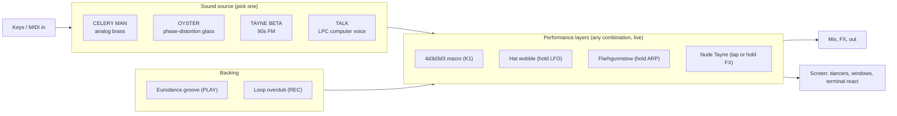

# CINCO 2.5 — Celery Man Custom Firmware for the M-VAVE FM-1

Turn the FM-1 into **Paul's COMPUTER**: a **playable instrument** whose 240×240 screen delivers the complete "Cinco Identity Generator 2.5" enterprise workstation experience. The identity routines are not a pre-recorded sequence. Each one is a **performance control** you can grab at any time and stack with the others: characters are voices, 4d3d3d3 is a macro knob, Nude Tayne crushes the audio and pixelates the dancer at the same time, and a corporate computer voice talks back and can be played from the keys.

**Base:** a fork of [hugelton/Felucca](https://github.com/hugelton/Felucca) (GPL-3.0). It already has a working hardware layer, the USB-MIDI flashing code, rescue mode, a Docker build that works on macOS, an Emscripten browser emulator, and host tests. We keep the hardware layer and a few synth engines, and replace the whole UI.

## Design principles
1. **Instrument first.** No gates, no required order, no modal screen that stops you playing. Every control acts instantly.
2. **Everything stacks.** Hat wobble + flarhgunnstow + Nude Tayne + 4d3d3d3 at max all at once should sound and look like chaos, and that's intended.
3. **The screen reacts to playing.** Dancers move to the groove and the keys. Windows, the terminal and dialog pop-ups respond to what you do.
4. **Voice responses as audio flavor.** Lines like "Yes, Paul.", "4d3d3d3 engaged." and "Not computing. Please repeat." are short reactions that never block. You can turn them down or off.

---

## Background (verified research)

| Area | Finding |
|---|---|
| MCU | JieLi AC7911B (AC791N/WL82), dual-core `pi32v2`. **Not ARM**: needs JieLi clang 4.0.1, run through Docker on macOS |
| Display | ST7789, 240×240 RGB565 over SPI. Felucca has **no full framebuffer**: it draws into horizontal strips of up to 240×124 (`cv_begin` / `cv_rect` / `cv_text` / `cv_blit`) |
| Inputs | 27 keys (F3–G5, no velocity), 14 buttons (`FX SCL ENV LFO EDIT GLO HOME SAVE ARP SEQ PLAY REC OCT- OCT+`), 7 encoders (`SELECT ALGO PRESET K1–K4`), volume pot |
| Audio | 44.1 kHz, 32-sample control blocks, 8 shared synth voices plus drum voices, 4 tracks. Audio math is **fixed-point only** |
| Flash | 1 MB total. **App partition is about 568 KB**, there's a 288 KB user-sample region, and settings/projects take the top 16 KB |
| Flashing | `.fwsc` files over USB-MIDI SysEx (WebMIDI installer / `fm1_install.py`). Stock firmware V14–V16 can be flashed back. There's a boot-loop guard, and holding OCT-+OCT+ for 5 s drops into the vendor bootloader (UBoot) |
| Build | `./build.sh` (Docker + toolchain + AC79 SDK). Emulator: `web/emu/build.sh`. Tests: `tests/run_tests.sh` |

**Corporate workstation voice lines** (verified workstation vocabulary): "Good morning, Paul. What will your first sequence of the day be?", "Yes, Paul.", "4d3d3d3 engaged.", "I have a BETA sequence…", "I can't wait to entertayne you.", "Not computing. Please repeat.", "This is not suitable for work. Are you sure?", "Okay.", "Loading, please wait…"

---

## User Review Required

> [!IMPORTANT]
> **Sprite art: rotoscoped pixel art (chosen for the best fidelity).** This is the classic *Prince of Persia* technique: authentic video footage sets the exact poses, timing and silhouettes, and the final sprites are pixel art redrawn on top of it.
> 1. **Chrome:** the desktop, windows, terminal, pop-ups and loading bar are drawn **in code** to match the workstation display pixel-for-pixel.
> 2. **Dancers:** isolated dancer footage on a white canvas provides ideal sources for rotoscoping. The pipeline is: extract keyframes → remove the background → shrink to sprite size → reduce each character to 16 colors → a cleanup pass that **rebuilds the pixels** (outlines, color clusters, no stray pixels). Faces and hats get hand-placed pixels on keyframes, since a face is only about 12 px tall. You approve every sheet.
> 3. **The repo:** raw frames and clips stay in a git-ignored `refs/` folder. Only the finished 16-color sprite sheets are committed.

> [!WARNING]
> **Rotoscoped sprites represent authentic Cinco executive personnel.** At 96×128 with 16 colors, sprite generation sits behind a clean pipeline. If there's ever a requirement, we can swap in alternative sprites without changing any code.

> [!WARNING]
> **Original audio synthesis.** We ship dedicated speech data: speech phonemes re-encoded into tiny LPC-10 / Speak & Spell-style data. The groove is an original electronic music pattern written in classic Eurodance style.

> [!CAUTION]
> **Brick safety.** Before we flash CINCO onto your device, Phase 7 starts by restoring the stock firmware and testing the rescue path. The boot-loop guard, the UBoot entry and the OTA SysEx handler stay untouched, and a test checks that they still exist.

## Decisions (confirmed)
- Control map: **approved** as written below.
- Computer voice: **macOS `say -v Fred`**, LPC-encoded.
- Sprites: **rotoscoped pixel art** (above). The wife interrupt is **cut**.

---

## Concept: an Instrument Made of Stackable Layers



| Layer | Sound | Screen |
|---|---|---|
| **Celery Man** | `ENG_ANALOG`: stiff square/saw "office brass" | Silver-suit robotic two-step |
| **Oyster** | `ENG_PHASE` (CZ-style): glassy and "smiling", with chorus | Flame toque, frozen grin |
| **Tayne (BETA)** | `ENG_FM6` with 4 built-in cheesy-90s patches (stab / slap bass / E.piano / brass) | Fedora and mustache, smooth moves |
| **Talk** | LPC computer voice. **Sing:** the keys play the selected phrase at pitch. **Soundboard:** each key fires a different phrase | Words type out in the terminal as they're spoken |
| **4d3d3d3** (K1, continuous) | Drive, chorus, brighter filter, busier groove, faster dancer frames | Dancer windows cascade 1 → 2 → 4 → 8. At max, the frames switch to the warped-grin face |
| **Hat wobble** (hold LFO) | Vibrato + tremolo synced to the tempo. K-depth on the service page | The hat-wobble loop plays on top of the current dance |
| **Flarhgunnstow** (hold ARP) | Chaos arpeggio over the held keys: random octaves, ratchets, slicer stutter. Notes snap to the scale | Flailing loop with jitter on the window position |
| **Nude Tayne** (FX: tap to latch, hold for momentary) | **Audio mosaic** (sample-rate and bit crush) + a filter that "thrusts" on the beat. K2 sets the mosaic amount | The sprite is drawn with the **same mosaic block size**. Works on **any** character. The first time it's engaged, a "NOT SUITABLE FOR WORK" pop-up flashes for about 1 s (non-blocking) |
| **Groove** (PLAY) | About 120 BPM Eurodance: 4-on-the-floor kick, offbeat open hats, octave bass, stabs. The last key held (or the loop) sets the root | Dancers move one frame per 8th note |
| **Loop** (REC) | Overdub what you play over the groove, 1/2/4 bars (uses `seq.c`) | A small "REC ●" badge on the title bar |
| **Printout of Oyster smiling** (SAVE) | Dot-matrix printer screech | A receipt slides out showing the patch name, and the patch is saved to a slot |

### Control Map

| Control | Function |
|---|---|
| Keys | Play the current source. **MIDI notes and CCs** over USB/TRS do the same |
| `PRESET` enc | Choose the source: Celery Man / Oyster / Tayne (BETA) / Talk. A short "Yes, Paul." plays as a reaction |
| `ALGO` enc | Patch variant (Talk: which phrase, or Soundboard at the end of the list) |
| `K1` | **4d3d3d3** ("4d3d3d3 engaged." plays once when you pass the first threshold, with a cooldown) |
| `K2` | Tone/filter. While Nude Tayne is on: **mosaic** |
| `K3` | Groove tempo (100–140 BPM) |
| `K4` | Balance between the groove and what you play |
| `SELECT` enc | Service page navigation |
| `FX` | **Nude Tayne:** tap to latch, hold for momentary |
| `LFO` (hold) | **Hat wobble** |
| `ARP` (hold) | **Flarhgunnstow** |
| `EDIT` | Jump straight to the Talk source and back |
| `PLAY` / `SEQ` | Groove start/stop / groove variation (A, B, fill on hold) |
| `REC` | Loop record/overdub. Hold to clear |
| `SCL` | Cycle the scale (minor / major / Phrygian / chromatic), used by flarhgunnstow and the groove |
| `SAVE` | Printout of Oyster smiling (save patch). `SAVE` + key = choose a slot |
| `HOME` | Panic: release everything and clear all the stacked layers |
| `GLO` | Service page: MIDI channel, how often the voice reacts (off / low / high), wobble depth |
| `OCT-` / `OCT+` | Octave (rescue/bootloader combos **kept exactly as in Felucca**) |
| `ENV` | Unused in v1 |

---

## Screen Design (240×240)

The layout is tightened from 4:3 TV to a square screen. Colors are sampled from the reference frames in Phase 1.

```
┌──────────────────────────────────────┐  desktop cyan ~#6DC0DB
│ ┌─[-]────── Celery Man ──────[▼][▲]┐ │  white title bar, 1px black outline,
│ │                                   │ │  grey 3D bevel (#FFF / #888 / #CCC)
│ │          (dancer sprite           │ │  dancer on a white canvas
│ │           ~96×128, 16 colors)     │ │  4d3d3d3 adds windows cascaded 12px apart
│ │                                   │ │
│ └───────────────────────────────────┘ │
│ ┌─ Paul's COMPUTER ─────────────────┐ │  sunken black terminal: reactions,
│ │ > 4d3d3d3 engaged._               │ │  knob values ("4d3d3d3: 87"),
│ └───────────────────────────────────┘ │  phrase text in Talk mode
└──────────────────────────────────────┘
```

Pop-ups (the NSFW warning, "Loading…" when the source changes, the printer receipt) are **brief overlays that never take input**, so the keys always play. To fit the strip model, the screen is split into 3 bands (title area / dancer body / terminal). Only bands that changed get redrawn, which keeps us inside the SPI bandwidth. Dancers play at about 12 fps, maintaining authentic workstation fidelity.

---

## Proposed Changes

Everything lives in `/Users/joshcaldwell/dev/celery-man`, a fork of Felucca with an `upstream` remote. Felucca builds as one big C file (`felucca.c` includes all sources), so new files are listed in that manifest.

### Phase 0: Fork and toolchain bring-up
- `git clone --recurse-submodules` Felucca into the workspace, add the `upstream` remote, and copy this plan to `docs/cinco/plan.md`.
- Install Docker, the JieLi toolchain (`tools/get_toolchain.sh`), the AC79 SDK and Emscripten. **Build stock Felucca**, build the emulator, and run `tests/run_tests.sh`.
- Check the scout claims against the real code: the API names, `app.ld` sizes, the rescue paths, and whether `perform.c` CRUSH and the `seq.c` arpeggiator/recording can be reused. Record the baseline binary size.

**Gate:** the stock build reproduces, the emulator runs, and the tests pass.

---

### Phase 1: References and art direction

#### [NEW] `tools/cinco/fetch_refs.py`
Downloads reference assets into `refs/` (git-ignored). Uses argparse.

#### [NEW] `docs/cinco/style.md`
Sampled palette, chrome measurements, the flavor lines, and each dancer's pose list with frame counts.

#### [NEW] `tools/cinco/mock_screen.py`
Renders 240×240 PNG mockups of the main states: idle, 4d3d3d3 ×8, everything stacked, Nude mosaic, Talk mode, the NSFW pop-up, and the printout.

**Gate: you approve the mockups.**

---

### Phase 2: Strip-down

#### [DELETE] Felucca UI
`ui.c ui_draw.c ui_input.c ui_events.c ui_graph.c ui_layer.c ui_menu.c ui_name.c ui_slice.c ui_fm6op.c ui_tools.c ui_help.c menu_items.c favorites.c category.c editor*.c`, plus their tests.

#### [DELETE] Unused engines
`eng_grain eng_phys phys_* eng_sample eng_slice slice_store eng_wheel eng_trio eng_noise eng_lofi eng_digital`. The final list depends on the flash budget. **Kept:** `ENG_ANALOG`, `ENG_PHASE`, `ENG_FM6`, `ENG_DRUM`, `fx.c`, `perform.c`, `slicer.c`, `seq.c`, `mod.c`, MIDI in/CC, and all of the hardware layer / OTA / loader / storage.

#### [MODIFY] `felucca.c`, `tools/build.py`
Update the source manifest. Change `FELUCCA_ID` to a new `CINCO` package ID. Product strings become "CINCO 2.5".

#### [NEW] `firmware/src/cinco_ui.c` (stub)
Provides the hooks the main loop calls (`ui_input`, `ui_leds`, `ui_draw`, `draw_splash`, `ui_message`).

**Gate:** the firmware and emulator build, the audio regression tests for the kept engines pass, and we have a flash size report.

---

### Phase 3: Graphics

#### [NEW] `tools/cinco/roto.py` (rotoscoping pipeline, depends on ffmpeg + Pillow + numpy)
Run per character and per move (`--clip refs/tayne_hatwobble.mp4 --fps 12 --box 96x128 --colors 16 --out assets/sprites/tayne_wobble.png`):
1. `ffmpeg` pulls frames at 12 fps (or picks keyframes by motion difference so loops close cleanly).
2. Background key: the white canvas becomes palette index 0, with alpha matting and a tight crop to a shared box so the feet stay planted.
3. Area-average shrink to the sprite box.
4. One fixed 16-color palette **per character**, shared by all its moves, chosen by k-means, no dithering.
5. Pixel cleanup: a 1-px dark outline, removal of stray and isolated pixels, merging of jagged color clusters, and steadying of colors between frames so nothing flickers.
6. Output: a sprite sheet PNG plus a GIF preview for review. Faces and hats are fixed by hand on keyframes in `assets/sprites/*.png`. The tool never overwrites a sheet marked `--locked`.

#### [NEW] `tools/cinco/gen_sprites.py`
Converts the approved sheets in `assets/sprites/` into C arrays with the 16-color palette and run-length compression. It fails the build if sprites go over 220 KB. The `CINCO_SPRITESET=roto|original` flag picks the sprite set.

```c
// firmware/src/cinco_assets.h (generated)
typedef struct {
  uint8_t  w, h, nframes, flags;   // flags: LOOP, GRIN_SWAP...
  const uint16_t *pal;             // 16 x RGB565 (swapped); index 0 = canvas white
  const uint32_t *frame_off;       // byte offset of each frame into rle[]
  const uint8_t  *rle;             // byte = (run-1)<<4 | color
} cinco_anim_t;
```

#### [NEW] `firmware/src/cinco_gfx.c`
Drawing primitives that work strip by strip: `win_draw`, `desktop_fill`, `term_draw`, `popup_draw`, `progress_draw`, `receipt_draw`, and `anim_blit(anim, frame, x, y, scale, mosaic)`.

#### [NEW] Fonts
An OFL/CC0 pixel font for the terminal and a small sans for titles, run through Felucca's existing `gen_aa_font.py`.

#### [NEW] `firmware/src/cinco_view.c`
A **performance state → screen** mapping, with no scripted scenes. It reads the current state each frame and derives what to draw: the dancer loop (base dance / wobble / flail / grin), how many windows to cascade (from K1), the mosaic size, any active overlays with expiry timers, and the terminal text queue.

```c
typedef struct {
  uint8_t source;            // CELERY, OYSTER, TAYNE, TALK
  uint8_t variant, k4d3d, tone, mosaic;
  uint8_t wobble:1, flail:1, nude:1, nude_latched:1, groove:1, rec:1;
  uint8_t scale, react_level;
} cinco_perf_t;              // single source of truth for sound + view
```

---

### Phase 4: Audio

#### [NEW] `firmware/src/cinco_lpc.c` + `cinco_phrases.c` (generated)
A TMS5220-style LPC filter in fixed-point Q15. The frame rate (40 Hz) is separate from the pitch, so in Sing mode the key sets the buzz period. It drives two things: a **reaction channel** (short lines with cooldowns, mixed after the FX, ducking under your playing) and **`ENG_TALK`**, an `engine_t` used for Sing and Soundboard modes. The whole phrase set fits in under 4 KB.

#### [NEW] `tools/cinco/gen_phrases.py`
Turns phrase text into C arrays: `say -v Fred` → 8 kHz WAV → LPC encoder → C arrays. Phrases: *Good morning Paul / Yes, Paul / 4d3d3d3 engaged / Not computing. Please repeat / Not suitable for work / Are you sure? / Okay / Loading, please wait / I have a BETA sequence / Entertayne you / Celery Man / Oyster / Tayne / Hat wobble / Flarhgunnstow / Nude Tayne / Computer*. That's enough to put a different phrase on every Soundboard key.

#### [NEW] `firmware/src/cinco_sound.c`
- Character patches, plus macro curves that map `K1` onto drive, chorus, filter, groove density and dancer fps.
- Hat wobble: a tempo-synced LFO routed to pitch and amp through `mod.c`.
- Flarhgunnstow: chaos settings for the `seq.c` arpeggiator, plus the slicer stutter, snapped to the scale.
- Nude Tayne: sample-and-hold decimation, bit quantize, and a filter pump synced to the beat. All of it works on any source and is tied to the visual `mosaic`.
- Synthesized SFX: printer screech, boot beep.

#### [NEW] `firmware/src/cinco_groove.c`
A pattern generator rather than stored patterns. Track 3 (`ENG_DRUM`) plays the kick, clap on 2 and 4, offbeat open hats and 16th closed hats. Track 1 plays octave-bounce bass and track 2 plays minor-triad stabs, both following the held key or the loop root and the scale. Variations A, B and fill come from `SEQ`, and K1 adds busier density layers.

#### [NEW] `firmware/src/cinco_loop.c`
REC overdub over the groove (1/2/4 bars), quantized to the groove clock. It reuses `seq.c` recording where possible, and stores note events only.

---

### Phase 5: Input and persistence

#### [MODIFY] `firmware/src/cinco_ui.c` (full version)
Turns buttons, encoders and MIDI notes/CCs into changes to `cinco_perf_t`, using the control map above. It still calls `master_poll`, keeps the boot and runtime rescue combos unchanged, and drives the LEDs (lit keys show the held notes, the scale, and the loop).

#### [NEW] `firmware/src/cinco_store.c`
The SAVE printout stores 8 patch slots (source, variant, the K1–K4 knob values, scale, groove settings, the loop) through the existing `storage.c` code.

---

### Phase 6: Tests and emulator

#### [NEW] `tests/cinco_render_test.c`
Renders the mockup states on the host (including everything stacked) and compares a hash against approved golden images.

#### [NEW] `tests/cinco_audio_test.c`
Fixed renders of each source, K1 sweeps, every combination of the layers (wobble, flail, nude), Sing/Soundboard, the groove, and the loop. Checks hash regressions, and that the output has no NaN, no DC, and no clipping past the limiter.

#### [NEW] `tests/cinco_input_test.c`
Feeds in scripted input sequences and checks that no combination locks up input or leaves notes hanging, and that every overlay times out.

#### [NEW] `tests/cinco_rescue_test.c`
Fails if the boot-loop guard, the OCT combos or the OTA SysEx handler get unlinked or changed.

#### [MODIFY] `web/emu/`
The emulator gets the CINCO UI, with a computer-keyboard map that matches the FM-1 panel.

---

### Phase 7: Hardware (when your FM-1 arrives)
1. Flash the stock firmware back with the official tool, to prove recovery works.
2. Test the OCT-+OCT+ runtime bootloader entry on stock Felucca.
3. Flash `CINCO.fwsc` and check: the display, all the controls, a worst-case CPU load test (groove + loop + 8 voices + every layer stacked), battery, USB/TRS MIDI.
4. Release: a GitHub repo, a `.fwsc` release, and a PR adding CINCO to the [aroum hub](https://github.com/aroum/fm1-custom-fw).

---

## Execution Model
I plan and review. Each phase is handed to `flash_worker` subagents with disjoint file ownership and an exact command that must pass. For example, the graphics (Phase 3) and audio (Phase 4) work run **in parallel**. All scripts live in `tools/cinco/*.py` and use argparse, with no inline code.

## Verification Plan

### Automated Tests
```bash
./build.sh                       # firmware .fwsc builds; size check: app <= 568 KB, sprites <= 220 KB
web/emu/build.sh                 # browser emulator builds
tests/run_tests.sh               # Felucca regressions for kept engines + cinco_render / audio / input / rescue
python3 tools/cinco/mock_screen.py --all --out docs/cinco/mock/   # Phase 1 mockups
```

### Manual Verification
- **Phase 1:** you approve the 240×240 mockups next to the reference frames.
- **Phase 3:** you approve each dancer sprite sheet.
- **Phase 6:** a **play test** in the browser emulator: jam over the groove, stack every layer, loop a phrase, and play the soundboard. I'll capture screenshots and a recording for the walkthrough.
- **Phase 7:** the on-device checklist above, run **after** the stock-restore test passes.
